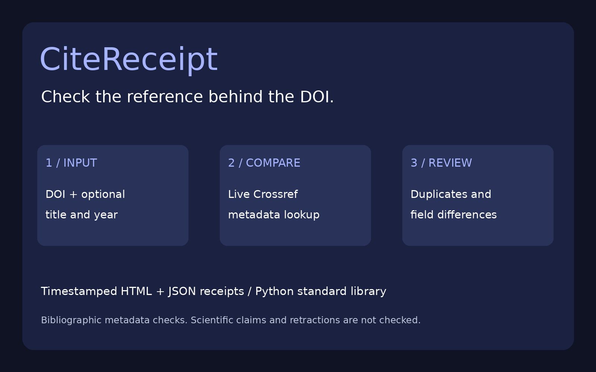
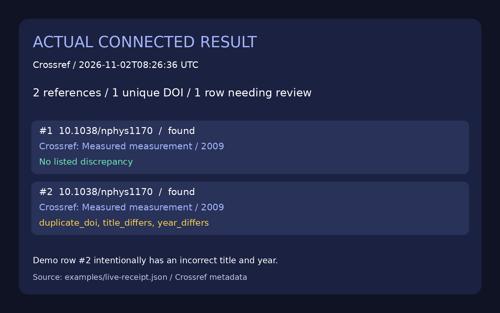

# CiteReceipt

    



**A timestamped receipt for the DOI, title and year in your bibliography.**

A reference can contain a real DOI and still point to a different title or year. CiteReceipt looks up each unique DOI in Crossref, compares the optional title/year you supplied, flags repeated DOIs and produces a readable HTML or JSON receipt. Useful for students, editors, researchers and people reviewing AI-assisted reference lists.

## Features

- Live Crossref metadata lookup; no account, API key or third-party Python package.
- DOI normalization across bare identifiers, `doi:` prefixes and `doi.org` URLs.
- Duplicate references reuse one response per run, while each row is checked separately.
- Title comparison normalizes Unicode, case, markup and punctuation; differences remain review items, not automatic corrections.
- Accepts any available publication year in `published`, `published-online` or `published-print`.
- Separates `not_found`, `error` and `not_checked` from found records.
- One request at a time, at least one second between unique lookups, bounded input/response sizes and a configurable timeout.
- Stops new requests after an HTTP/network/malformed-data error. No retry loop or silently cached fallback.
- Static HTML and structured JSON, with UTC check time and source-record URLs.

## Installation

Requires Python 3.10+ with standard-library HTTPS support.

```bash
git clone https://github.com/dxrkf/citereceipt.git
cd citereceipt
python citereceipt.py --help
```

## Input

Create a UTF-8 JSON array of 1–100 objects. Only `doi` is required; `title` and `year` are optional. Unknown fields are rejected to catch mistakes before network requests. Years must be integers from 1000–9999. Input is limited to 2 MB.

```json
[
  {"doi": "10.1038/nphys1170", "title": "Measured measurement", "year": 2009},
  {"doi": "https://doi.org/10.1038/nphys1170", "title": "A deliberately incorrect demonstration title", "year": 2025}
]
```

The second reference is deliberately wrong demonstration data. It does not describe an actual user's bibliography.

## Usage

```bash
python citereceipt.py examples/references.json
python citereceipt.py examples/references.json --html receipt.html
python citereceipt.py examples/references.json --json > receipt.json
```

Actual connected demonstration, checked **2026-11-02 08:26 UTC**:

```text
CiteReceipt: 2 references, 1 unique DOIs, 1 rows with issues
#1 10.1038/nphys1170 | found | no listed discrepancy
#2 10.1038/nphys1170 | found | duplicate_doi, title_differs, year_differs
Metadata comparison only; scientific claims and retraction status are not checked.
```

The terminal rendering above represents the captured [live JSON receipt](examples/live-receipt.json). The actual connected invocation used `--json --html examples/live-receipt.html`, returning exit code **1**, as expected for a demonstration with discrepancies. The [HTML receipt](examples/live-receipt.html) can be downloaded and opened in a browser; GitHub may show its source.



A result row includes:

```json
{
  "reference": 2,
  "duplicate_of": 1,
  "status": "found",
  "titles": ["Measured measurement"],
  "publication_years": [2009],
  "issues": ["duplicate_doi", "title_differs", "year_differs"]
}
```

### Exit codes

| Code | Meaning |
| --- | --- |
| `0` | Complete lookup; no listed discrepancies in the fields supplied |
| `1` | Complete lookup; at least one row needs review, including a duplicate or Crossref 404 |
| `2` | Invalid input/output, or incomplete check after an API/network/data error |

`--timeout 1..60` controls the per-request timeout (default 25 seconds). There is no scheduler or notification service. Reports are static; rerun to refresh.

An incomplete report can still contain useful successful lookups, and is explicitly marked `incomplete: true`. A Crossref 404 does **not** prove a DOI is invalid: the identifier may belong to a different registration agency. Missing title/year metadata becomes `title_unavailable` or `year_unavailable` when that field was supplied for comparison.

HTML output atomically replaces the explicitly selected file and refuses symlinks or the input path. On invalid input, an old HTML file can remain; check its timestamp and exit status. Shell `>` redirection can truncate a previous JSON file even on failure. For automation, write to a temporary path and inspect the exit code before replacing an earlier report.

## Online access, privacy and costs

The tool uses the public endpoint `https://api.crossref.org/works/{doi}`. No paid resource, token or subscription is created. Crossref's public API is available without registration, subject to request limits. Calls are serial and paced; HTTP errors stop further unique requests. If rate-limited, wait and rerun later at a lower frequency. This small-batch tool is not intended for corpus harvesting.

Only normalized DOIs are sent. Expected titles and years stay local. Crossref receives your IP/network address and requested identifiers; avoid sending confidential research interests. Reports contain your supplied bibliography and should be reviewed before sharing. There is no telemetry, publisher-page fetching, full-text download or automatic DOI URL navigation. HTTP redirects are refused.

Metadata comes from [Crossref](https://www.crossref.org/). See the [official REST API documentation](https://www.crossref.org/documentation/retrieve-metadata/rest-api/) and [access/rate-limit guidance](https://www.crossref.org/documentation/retrieve-metadata/rest-api/access-and-authentication/). Only DOI, title and publication-year metadata are retained; abstracts are not retrieved into the report. The MIT code license does not grant rights to papers or full text.

## Limits and interpretation

- This compares deposited bibliographic metadata. It does **not** verify scientific accuracy, authorship, peer review, retraction status or whether a paper supports a claim.
- `no listed discrepancy` only covers fields you supplied. A DOI-only entry performs a lookup and duplicate check, not title/year verification.
- Title matching is deterministic, not semantic or fuzzy. Subtitles, transliteration, markup boundaries or different wording can require manual review. Punctuation-only differences may be ignored.
- The DOI syntax check is intentionally conservative. Remove surrounding citation punctuation yourself; the tool does not guess where a DOI ends.
- Crossref coverage and metadata completeness vary. Other DOI registration agencies are not queried.
- Publication dates can differ between online and print. Any available supported publication year is accepted; acceptance does not validate a citation style's required year.
- No BibTeX, RIS, PDF extraction, author matching, bulk search or correction of source files. JSON keeps the input format explicit.
- Live availability and rate limits are outside this project's control. A successful example is evidence of one request, not long-term uptime.

## Tests

```bash
python -m unittest -v
```

19 deterministic tests cover DOI forms and invalid input, Unicode/markup normalization, matching and mismatching metadata, missing values, duplicate request reuse, serial pacing, stop-on-error behavior, fixed-host URL encoding, publication-year variants, unexpected DOI responses, malformed payloads, 404/429/network failures, response limits, HTML escaping and atomic/symlink output handling. Tests use injected responses; the checked-in demonstration was tested separately against the live API.

## GitHub topics

`crossref` `doi` `citations` `bibliography` `research-tools` `python` `cli` `data-quality`

Code license: MIT. Project post drafts: [POST.md](POST.md).
